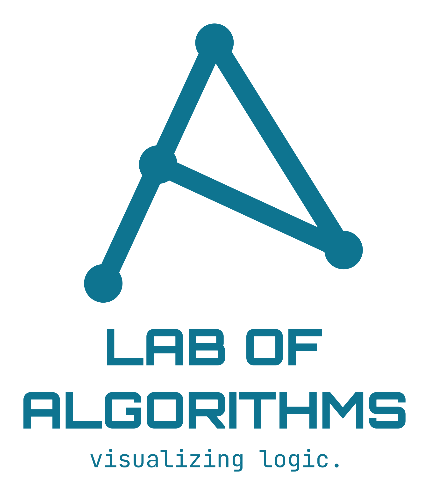
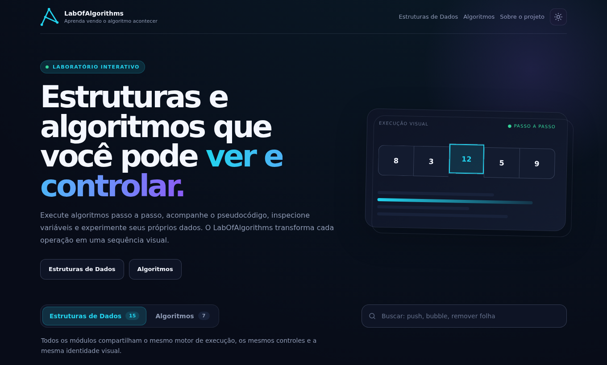
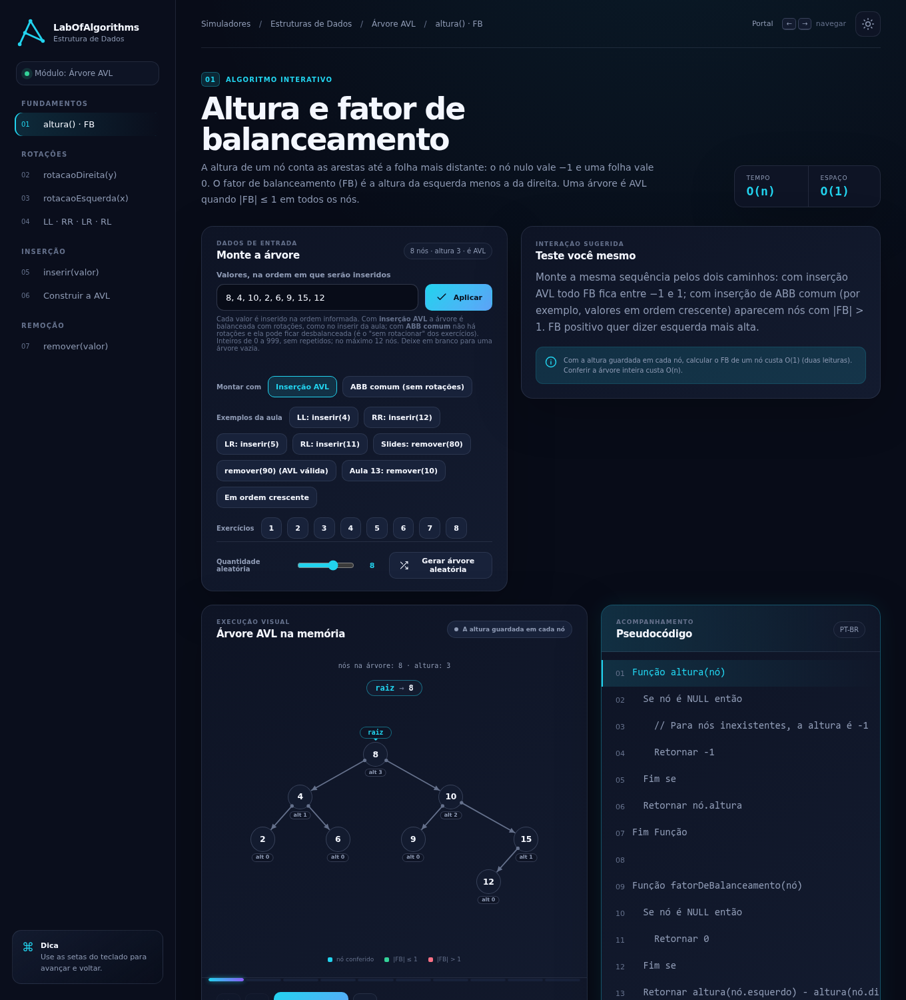

  <picture>
    <source media="(prefers-color-scheme: dark)" srcset="assets/logo/logo-on-dark.svg" />
    
  </picture>

# LabOfAlgorithms

Simuladores interativos para aprender estruturas de dados e algoritmos. Cada operação roda passo a passo, com o pseudocódigo destacado, as variáveis e o console ao lado, e você pode usar os seus próprios dados.

**Acesse: [labofalgorithms.com](https://labofalgorithms.com)** · English: [labofalgorithms.com/en](https://labofalgorithms.com/en/)

  
  

## Simuladores

São 24 simuladores, em português e em inglês, no navegador e sem cadastro. O que cada um cobre está no [catálogo detalhado](docs/SIMULADORES.md).

### Estruturas de Dados

- [Vetores](https://labofalgorithms.com/simuladores/vetores/)
- [Matrizes](https://labofalgorithms.com/simuladores/matrizes/)
- [Pilhas](https://labofalgorithms.com/simuladores/pilhas/)
- [Filas](https://labofalgorithms.com/simuladores/filas/)
- [Listas](https://labofalgorithms.com/simuladores/listas/)
- [Alocação Dinâmica](https://labofalgorithms.com/simuladores/alocacao-dinamica/)
- [Pilhas Dinâmicas](https://labofalgorithms.com/simuladores/pilhas-dinamicas/)
- [Filas Dinâmicas](https://labofalgorithms.com/simuladores/filas-dinamicas/)
- [Listas Dinâmicas](https://labofalgorithms.com/simuladores/listas-dinamicas/)
- [Listas Circulares](https://labofalgorithms.com/simuladores/listas-circulares/)
- [Listas Duplamente Encadeadas](https://labofalgorithms.com/simuladores/listas-duplamente-encadeadas/)
- [Tabelas Hash](https://labofalgorithms.com/simuladores/tabelas-hash/)
- [Árvore Binária de Busca](https://labofalgorithms.com/simuladores/arvore-binaria-busca/)
- [Percursos em Árvores Binárias](https://labofalgorithms.com/simuladores/percursos-arvores-binarias/)
- [Árvore AVL](https://labofalgorithms.com/simuladores/arvore-avl/)

### Algoritmos

- [Recursão](https://labofalgorithms.com/simuladores/recursao/)
- [Buscas](https://labofalgorithms.com/simuladores/buscas/)
- [Shotgun Sort](https://labofalgorithms.com/simuladores/shotgun-sort/)
- [Selection Sort](https://labofalgorithms.com/simuladores/selection-sort/)
- [Bubble Sort](https://labofalgorithms.com/simuladores/bubble-sort/)
- [Insertion Sort](https://labofalgorithms.com/simuladores/insertion-sort/)
- [Merge Sort](https://labofalgorithms.com/simuladores/merge-sort/)
- [Quick Sort](https://labofalgorithms.com/simuladores/quick-sort/)
- [Heap Sort](https://labofalgorithms.com/simuladores/heap-sort/)

## Para quem usa

- **Estudantes:** avance e volte um passo de cada vez, mude a velocidade, informe valores próprios ou gere dados aleatórios, e alterne entre o tema claro e o escuro.
- **Professores:** os simuladores funcionam em sala de aula, direto no navegador, e o conteúdo didático pode ser adaptado (veja a [licença](#licença)).

## Recursos

Os módulos possuem execução automática, avanço e retorno manuais, controle de velocidade, pseudocódigo destacado, variáveis, console, entrada manual, geração aleatória e tema claro/escuro.

## Página inicial

O catálogo tem duas abas, Estruturas de Dados e Algoritmos, e uma busca entre os módulos (atalho `/`). A aba aberta fica salva no navegador, e os links `#estruturas` e `#algoritmos` abrem a aba correspondente. O código está em `src/js/pages/home-catalog.js`.

## Contagem de acessos

O site conta acessos de forma anônima com o [GoatCounter](https://www.goatcounter.com): sem cookies e sem guardar o IP. O painel fica em `https://labofalgorithms.goatcounter.com`. A contagem não roda em `localhost`, e as trocas de simulador no menu lateral aparecem como eventos (`modulo/simulador`). O código está em `src/js/core/analytics.js`.

## Documentação

- [Catálogo dos simuladores](docs/SIMULADORES.md): o que cada módulo simula.
- [Arquitetura](docs/ARCHITECTURE.md): motor de simulação, módulos, renderizadores e convenções.
- [Desenvolvimento](docs/DESENVOLVIMENTO.md): como rodar, verificar e publicar, e como criar um novo simulador.

## Contato e contribuições

Encontrou um erro ou tem uma sugestão? Abra uma [issue](https://github.com/labofalgorithms/simulator-web/issues) ou escreva para [contact@labofalgorithms.com](mailto:contact@labofalgorithms.com).

## Licença

- **Código-fonte:** todos os direitos reservados. O repositório é público para consulta e para publicar o site, mas o código não pode ser copiado nem reutilizado sem autorização.
- **Conteúdo didático** (textos, explicações e pseudocódigos dos simuladores): [CC BY-NC 4.0](https://creativecommons.org/licenses/by-nc/4.0/deed.pt-br). Pode ser compartilhado e adaptado, com citação do autor e sem fins comerciais.
- **Marca e logotipo:** todos os direitos reservados.

O texto completo está em [LICENSE](LICENSE). Para pedir autorização de uso, escreva para [contact@labofalgorithms.com](mailto:contact@labofalgorithms.com).
